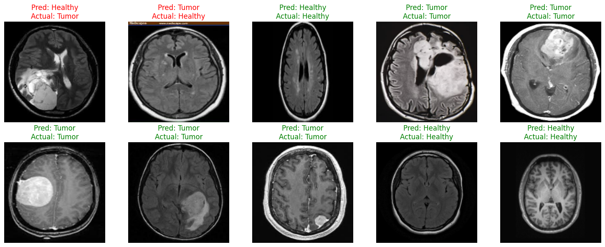

# Critical Code Response: Automating Medical Diagnosis

### Context: Google DevFest and Applied AI
This project is a creative response to **Abdul Zedan's** talk on Applied AI and **DeepMind's AlphaFold** at the Google DevFest. Inspired by the potential of AI to solve complex biological problems (like protein folding), I explored how "computer vision" can be applied to detecting brain tumors in MRI scans.

### The Artefact: Convolutional Neural Network (CNN)
I built a CNN using PyTorch to classify MRI scans as either "Healthy" or containing a "Tumor." The model acts as a "second set of eyes" to reduce the cognitive load on radiologists.

### Results
The model was trained for 10 epochs. Below is the model predicting diagnoses on unseen validation data:

*(Green text indicates a correct prediction by the AI)*

### Process Work: Training Performance
The following graphs visualize the learning process. You can see the training loss decreasing and accuracy improving over time, indicating the model successfully learned to distinguish features in the MRI scans without overfitting.

### Technical Stack
* **Framework:** PyTorch
* **Architecture:** 2x Convolutional Layers + Max Pooling + Fully Connected Layers
* **Data:** Brain MRI Images for Brain Tumor Detection
* **Dataset Source:** [Kaggle Dataset Link](https://www.kaggle.com/datasets/navoneel/brain-mri-images-for-brain-tumor-detection)

### How to Run
1.  Clone the repository.
2.  Open `MRI_Tumor_Detection.ipynb` in Jupyter or Google Colab.
3.  **Run the training loop yourself:** The notebook is set up to download the dataset directly from Kaggle and train the model from scratch. Simply execute all cells to reproduce the results and graphs shown above.
